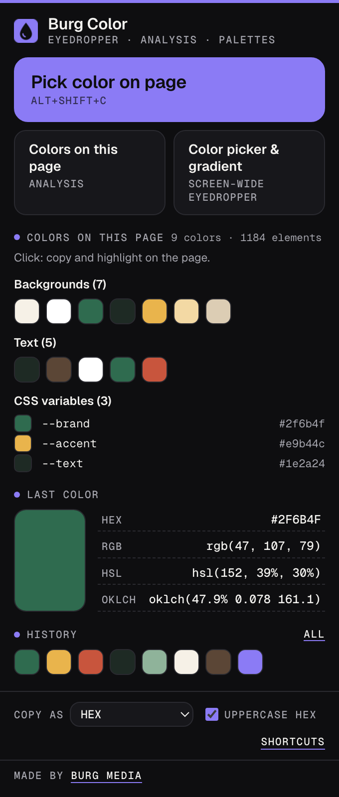
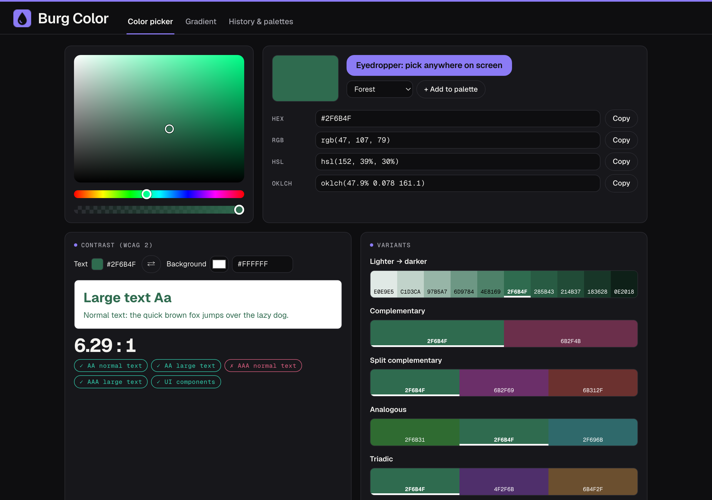
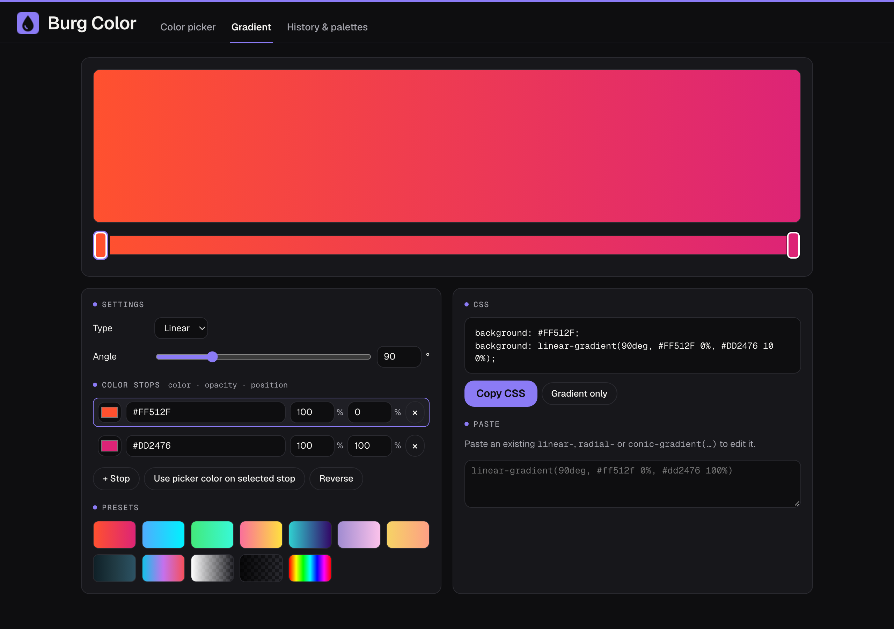

# Burg Color

A Chrome extension to pick any color from a web page with a magnifying eyedropper, list the colors a page uses, check WCAG contrast and build CSS gradients and palettes.





## Features

- **Eyedropper with magnifier.** Point at any pixel on the page and the color is copied to your clipboard. It reads the actual rendered pixel, so it also works on photos, gradients, shadows and canvas. The magnifier shows the element under the cursor (tag, id, class).
- **Precise picking.** Arrow keys move 1 pixel (10 with Shift), Shift+click picks several colors in a row, Enter picks, Esc or right-click stops.
- **Keyboard shortcut.** Alt+Shift+C (Option+Shift+C on macOS) starts the eyedropper. You can change it under `chrome://extensions/shortcuts`.
- **Colors on this page.** One overview of the background, text, border and SVG colors of the visible elements, with how often each one is used, plus the color variables (`--name`) defined on `:root` or `html`. Click a color to copy it and outline the elements that use it.
- **Copy in your format.** HEX (with or without `#`, upper or lower case), RGB, HSL or OKLCH.
- **Color picker.** Hue, saturation, brightness and opacity, with input fields for HEX, RGB, HSL and OKLCH. Also accepts color names, `oklab()` and `color(srgb …)`.
- **Screen-wide eyedropper.** On the color picker page you can pick a color anywhere on your screen, also outside the browser (uses the browser's built-in EyeDropper API, where available).
- **WCAG 2 contrast check.** AA and AAA for normal and large text, plus 3:1 for UI components, with a live preview. The ratio is never rounded up.
- **Variants.** Lighter and darker shades, and complementary, split complementary, analogous, triadic and tetradic harmonies.
- **Gradient generator.** Linear, radial or conic, with draggable color stops (color, opacity, position), presets and ready-to-use CSS with a solid fallback. Paste an existing `linear-`, `radial-` or `conic-gradient(…)` to edit it.
- **History and palettes.** Your last 60 colors are kept. Organize colors in your own palettes and copy a palette as CSS variables or JSON.
- **Toolbar icon** shows the last picked color.
- **English and Dutch** interface, following your browser language.



## Install from source (Developer mode)

The easiest way to install Burg Color is the Chrome Web Store version, linked from the [Burg Color page](https://burgmedia.eu/shop/burg-color). That version updates automatically. If you prefer to run the code from this repository, it takes a minute:

1. **Download the code.** Click the green **Code** button on this page and choose **Download ZIP**, or download the zip from [Releases](../../releases). Unzip it.
2. **Open the extensions page.** Type `chrome://extensions` in the address bar and press Enter.
3. **Turn on Developer mode.** Use the **Developer mode** switch in the top right corner.
4. **Load the extension.** Click **Load unpacked** and choose the unzipped folder (the folder that contains `manifest.json`).
5. **Pin it.** Click the puzzle piece icon in the toolbar and pin Burg Color, so the icon is always visible.

Good to know:

- **Other browsers.** This also works in other Chromium based browsers, such as Microsoft Edge (`edge://extensions`), Brave (`brave://extensions`) and Opera (`opera://extensions`). The steps are the same; the Developer mode switch may be in a different place on the page. Burg Color needs version 116 or newer.
- **No automatic updates.** An extension loaded this way does not update itself. To update, download the new version, replace the folder and click the **Reload** icon on the Burg Color card in `chrome://extensions`.
- **Developer mode notice.** Chrome may remind you that extensions in developer mode are running. That is normal for extensions you load yourself.

## Check it yourself with your AI agent

The code is small, has no build step and is not minified, so you don't have to take our word for anything. Point your own AI agent (Claude Code, Cursor, Copilot, ChatGPT) at this folder and let it check.

```text
Audit this Chrome extension for security and privacy before I install it.
1. List every permission in manifest.json and whether the code actually needs it.
2. Find every network request (fetch, XMLHttpRequest, WebSocket, sendBeacon, image or
   script URLs, remote code) and tell me where data goes.
3. Check for remote code execution: eval, new Function, remotely loaded scripts.
4. Check what is stored (chrome.storage, IndexedDB, cookies) and whether anything
   leaves my browser.
5. Check content scripts: which sites they run on and what they read from pages.
6. Give a verdict: safe to install or not, with file and line references.
```

The fastest manual check, from inside the folder:

```sh
grep -rn "fetch\|XMLHttpRequest\|http" .
```

Besides this README you will find the burgmedia.eu links described below, one `fetch()` that loads the extension's own icon file, and a few URLs in comments.

## Privacy and security

- **No account, no analytics, no tracking, no ads.**
- **No remote code.** All JavaScript is in this repository. There are no CDNs or external scripts, and the extension pages only allow scripts from the extension itself (`script-src 'self'` in `manifest.json`). The fonts (Geist and Geist Mono) are included in `fonts/`.
- **No requests to servers.** The extension does not send data anywhere. The only `fetch()` in the code loads the bundled icon (`images/icon_16.png` and `icon_32.png`) to draw the color dot on it.
- **Page access only when you ask.** Burg Color looks at a page only after you click the toolbar icon and choose an action, or press the shortcut, and only in that tab. There are no content scripts that run on every site.
- **Eyedropper screenshot stays in memory.** To read the exact pixel color, the extension takes a screenshot of the visible part of the tab. The image is decoded in memory in that tab, replaced when you scroll and discarded when you stop. It is never saved or sent.
- **Page analysis reads colors only.** "Colors on this page" reads the computed colors of visible elements and the color variables in the page's stylesheets. The magnifier shows the tag, id and class of the element under the cursor. None of this is stored, except a color you click.
- **Stored locally.** In `chrome.storage.local` on your device: your settings, the last picked color, a history of up to 60 colors, your palettes with the names you give them, and the last color in the color picker. No URLs, page titles or browsing history. Nothing is synced. **Clear** on the History page empties the history; removing the extension removes everything.
- **Clipboard.** Burg Color writes the color or CSS you copy to the clipboard. It never reads the clipboard.

What does go out, and when:

- **After installing**, a welcome page opens once on burgmedia.eu (`https://burgmedia.eu/extensies/burg-color/welkom/`). **After removing** the extension, Chrome opens a short page there (`…/verwijderd/`). Both URLs carry only fixed labels (`utm_source=burg-color&utm_medium=extension&utm_campaign=install` or `uninstall`). No settings, colors, identifiers or browsing data are added. It is a normal page visit, so burgmedia.eu sees what any website sees, such as your IP address and browser; the privacy policy of burgmedia.eu applies there.
- **"Made by Burg Media"** at the bottom of the popup is a link with the same kind of labels (`utm_campaign=popup`). It opens only when you click it.

Found a security problem? See [SECURITY.md](SECURITY.md).

## Why is this free?

Burg Media is a small web studio in the Netherlands. We build these tools for our own work and give them away: no ads, no premium tier, no data collection. If they are useful to you, that is the best introduction to what we do. We build websites, web apps and custom software: [burgmedia.eu](https://burgmedia.eu)

## Permissions explained

| Permission | Why Burg Color needs it |
|---|---|
| `activeTab` | Gives temporary access to the current tab only, and only after you click the toolbar icon or press the shortcut. Needed to start the eyedropper there, take the screenshot it reads pixels from, and analyze the page's colors. No access to other tabs or sites. |
| `scripting` | Injects the bundled eyedropper, the color analysis and the temporary outline around elements into that tab, and sets a crosshair cursor while picking. Only after your click or shortcut, and only code from this repository. |
| `storage` | Saves your settings, color history, palettes and last color locally on your device (`chrome.storage.local`). |
| `clipboardWrite` | Copies the picked color, CSS variables or gradient CSS to the clipboard, also while you pick directly on a web page. The clipboard is never read. |

There are no `host_permissions` and no content scripts in `manifest.json`: Burg Color cannot read or change any website on its own. The `commands` entry in the manifest is the keyboard shortcut, not a permission.

## Alternatives

Looking for an alternative to ColorZilla, ColorPick Eyedropper or a separate contrast checker and gradient generator? Burg Color covers that everyday work in one extension: picking a color from any pixel on a page, seeing every color a site uses including its CSS variables, testing text against WCAG and turning colors into gradients and palettes. It needs no account, asks for no access to your sites until you click, and the source is right here for you to read.

## License

[MIT](LICENSE), Copyright (c) 2026 Burg Media. Third-party components and their licenses are listed in [NOTICE.md](NOTICE.md).

Made by [Burg Media](https://burgmedia.eu).
